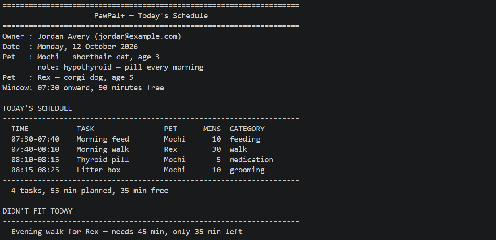
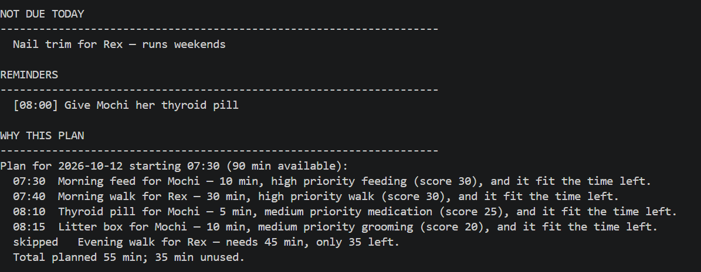
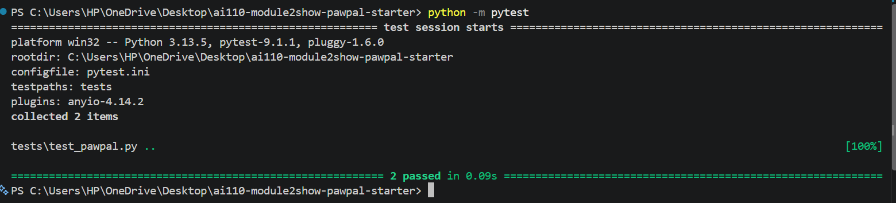
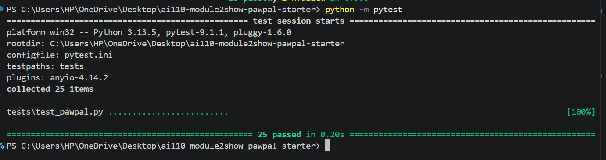

# PawPal+ (Module 2 Project)

You are building **PawPal+**, a Streamlit app that helps a pet owner plan care tasks for their pet.

## Scenario

A busy pet owner needs help staying consistent with pet care. They want an assistant that can:

- Track pet care tasks (walks, feeding, meds, enrichment, grooming, etc.)
- Consider constraints (time available, priority, owner preferences)
- Produce a daily plan and explain why it chose that plan

Your job is to design the system first (UML), then implement the logic in Python, then connect it to the Streamlit UI.

## What you will build

Your final app should:

- Let a user enter basic owner + pet info
- Let a user add/edit tasks (duration + priority at minimum)
- Generate a daily schedule/plan based on constraints and priorities
- Display the plan clearly (and ideally explain the reasoning)
- Include tests for the most important scheduling behaviors

## Getting started

### Setup

```bash
python -m venv .venv
source .venv/bin/activate  # Windows: .venv\Scripts\activate
pip install -r requirements.txt
```

### Suggested workflow

1. Read the scenario carefully and identify requirements and edge cases.
2. Draft a UML diagram (classes, attributes, methods, relationships).
3. Convert UML into Python class stubs (no logic yet).
4. Implement scheduling logic in small increments.
5. Add tests to verify key behaviors.
6. Connect your logic to the Streamlit UI in `app.py`.
7. Refine UML so it matches what you actually built.

## 🖥️ Sample Output

Paste a sample of your app's CLI or Streamlit output here so a reader can see what a generated plan looks like:
Portion 1:

Portion 2:



## 🧪 Testing PawPal+

```bash
# Run the full test suite:
python -m pytest

# Run with coverage:
pytest --cov
```

Sample test output:
Confidence Level: 4
```


```

## ✨ Features

- **Priority-based daily planning:** `Scheduler.schedule_tasks()` ranks tasks by priority score, then shorter duration, then name. It fits tasks into the owner's free minutes one at a time, highest-ranked first, and skips any that no longer fit. `generate_daily_plan()` then gives each planned task a back-to-back time slot from the start time.
- **Health tie-breaker:** medication and vet tasks get a +5 score bonus. This breaks ties within a priority level, but never lifts a task above a higher priority (HIGH = 30, MEDIUM = 20, LOW = 10).
- **Sorting by time:** `Scheduler.sort_by_time()` orders tasks by `"HH:MM"`, earliest first, using a lambda sort key. Unpadded times such as `"7:30"` are normalized, tasks with no time go last, and tasks with the same time keep their order.
- **Filtering by pet and status:** `Scheduler.filter_tasks()` keeps one pet's tasks (case-insensitive), done or unfinished tasks, or both at once. The result can then be sorted.
- **Recurrence rules:** `Task.is_due_today()` decides whether a task belongs on a date. It understands `daily`, `weekly`, `weekdays`, `weekends`, day lists like `mon,wed,fri`, and one-off tasks, and nothing is due before its `due_date`.
- **Daily and weekly recurrence:** completing a `daily` or `weekly` task with `Pet.complete_task()` creates its next occurrence, due 1 or 7 days later. It handles month, year and leap-day boundaries, and a repeat click can't queue two copies.
- **Conflict warnings:** `Scheduler.detect_conflicts()` flags tasks that start at the same time, for the same pet or different pets. It returns warning messages and never crashes, even on a malformed time.
- **Explained plans:** `Scheduler.explain_plan()` says why each task was planned (its priority, category and score) or skipped (not enough time left).
- **Reminders:** `Scheduler.send_reminders()` sends each planned task's unsent reminders once.

## 📐 Smarter Scheduling

All scheduling logic lives in [`pawpal_system.py`](pawpal_system.py). `Scheduler` and `Owner` are aliases for the UML's `Schedule` and `User` classes.

| Feature | Method(s) | Notes |
|---------|-----------|-------|
| Task sorting | `Scheduler.sort_by_time()`, `Scheduler.schedule_tasks()` | Sorts by clock time, earliest first. The day plan is ordered by priority, then duration |
| Filtering | `Scheduler.filter_tasks()`, `Task.is_due_today()`, `Task.fits_in()` | Filters by pet and/or completion status. Skips tasks not due today or that don't fit the time left |
| Conflict handling | `Scheduler.detect_conflicts()` | Warns when two or more tasks start at the same time, for the same pet or different pets |
| Recurring tasks | `Task.mark_complete()`, `Task.next_occurrence()`, `Pet.complete_task()` | Completing a daily or weekly task creates its next occurrence automatically |

### Sorting by time: `Scheduler.sort_by_time(tasks=None)`

Returns tasks ordered by `scheduled_time`, earliest first. The sort key is a lambda, `lambda task: _time_sort_key(task.scheduled_time)`, which returns the pair `(time_is_missing, "HH:MM")`:

- Each time is re-formatted zero-padded first, so `"7:30"` sorts as `"07:30"` (before `"10:00"`, not after it as plain text would). Once padded, `"HH:MM"` strings sort correctly as text (`"07:05" < "09:00" < "14:30"`).
- The first part of the key puts tasks with no time, or an unreadable one, **last** instead of first.
- Tasks with the same time keep their original order (the sort is stable).
- Returns a new list and leaves the input unchanged. Defaults to the schedule's candidate tasks.

The day plan uses a separate sort. `Scheduler.schedule_tasks()` orders tasks by `Task.priority_score()` (highest first), then shorter duration, then name, and fits as many as it can into the available minutes. Medication and vet tasks get a small score bonus that breaks ties within a priority level, but never lifts them above a higher priority.

### Filtering: `Scheduler.filter_tasks(tasks=None, *, is_complete=None, pet_name=None)`

Returns the tasks that match every filter you pass:

```python
schedule.filter_tasks(pet_name="Rex")                     # all of Rex's tasks
schedule.filter_tasks(is_complete=False)                  # unfinished tasks
schedule.filter_tasks(pet_name="Rex", is_complete=False)  # both at once
schedule.sort_by_time(schedule.filter_tasks(pet_name="Mochi"))  # filter, then sort
```

- A filter left as `None` is ignored, so passing neither returns every task.
- Pet names match regardless of case (`"rex"` finds Rex's tasks).
- The filters are keyword-only, so a bare `True` can't land in the wrong argument.
- One pass over the list that keeps the input order, so it combines with `sort_by_time()` in either order.

When building the day plan, the planner also filters automatically:

- `Owner.get_due_tasks()` uses `Task.is_due_today()` to drop tasks that are complete or not due on the date. It understands `daily`, `weekly`, `weekdays`, `weekends` and day lists such as `mon,wed,fri`, and nothing is due before its `due_date`.
- `Task.fits_in()` moves any task that doesn't fit the remaining time to `skipped_tasks`. `Scheduler.explain_plan()` then says why each one was skipped.

### Conflict detection: `Scheduler.detect_conflicts(tasks=None)`

Returns a list of warning strings, one for each time slot claimed by two or more tasks. An empty list means no conflicts.

```
WARNING: 2 tasks at 07:30, same pet (Mochi): Morning feed for Mochi, Brushing for Mochi.
WARNING: 2 tasks at 08:00, different pets: Thyroid pill for Mochi, Breakfast for Rex.
```

- **Lightweight by design:** tasks clash only when they **start at the same time**. Overlapping durations (a 30-minute walk at 07:00 and a feed at 07:15) are not flagged.
- **Two passes:** first it groups tasks by start time in a dictionary, then it reports every group with more than one task, in clock order.
- **Same pet or different pets:** each warning says which, and names every task involved.
- **What it skips:** tasks that are complete, have no time, or aren't due on the schedule's date. For example, today's finished Litter box and tomorrow's queued Litter box don't clash.
- **Times are normalized:** `"7:30"` and `"07:30"` count as the same slot.
- **It never crashes:** a bad time such as `"noon"` becomes its own warning instead of raising an error.

Run it **before** `generate_daily_plan()`. Planning gives each task its own back-to-back slot, so a generated plan never has conflicts. `main.py` prints these warnings in its **TIME CONFLICTS** section.

### Recurring tasks: `Task.mark_complete()`, `Task.next_occurrence()`, `Pet.complete_task()`

When a `daily` or `weekly` task is marked complete, a new copy is created for its next occurrence:

```python
next_feed = mochi.complete_task(feed, "2026-10-12")
next_feed.due_date   # "2026-10-13" (a weekly task would give "2026-10-19")
```

- **`Task.mark_complete(on_date)`** marks the task done and returns the next occurrence, or `None`. Calling it again on a finished task returns `None`, so a double-click can't queue two copies.
- **`Task.next_occurrence(on_date)`** builds the copy with `dataclasses.replace()`. It keeps the name, pet, duration, priority and preferred time, and gets fresh, unsent reminders.
  - The new `due_date` is 1 day (daily) or 7 days (weekly) after whichever is later: the completion date or the old due date. A task finished early still moves a full step ahead, and a late one never comes back due in the past.
- **`Pet.complete_task(task, on_date)`** marks the task done **and** adds the new copy to the pet's task list. A Task doesn't know which pet it belongs to, so use this instead of calling `mark_complete()` alone. The finished task stays on the list as a record.
- **`Task.due_date`** keeps the new copy out of plans until its day. A `weekly` task then repeats on that same weekday.

Only `daily` and `weekly` create a new copy. A `weekdays`, `weekends` or one-off task is simply marked done; `Task.reset()` makes it plannable again.

In the Streamlit app, ticking a task under **Mark tasks done** calls `Pet.complete_task()` with the plan's date and shows when the next one is due.

## 📸 Demo Walkthrough

Start the app with `streamlit run app.py`, or run the terminal demo with `python main.py`.

### Main UI features

The Streamlit page is one scrolling screen with four sections:

| Section | What you can do |
|---------|-----------------|
| **Owner details** | Edit the owner's name and email (collapsed by default). |
| **Add a Pet** | Enter a name, species, breed, age and medical notes. A table lists every pet and how many tasks it has. |
| **Schedule a Task** | Pick a pet and enter a title, category, duration, priority, frequency (daily, weekly, weekdays, weekends or one-off), a preferred time and an optional reminder time. Times that aren't `HH:MM` are rejected with a warning. Below the form, **Your tasks** lists every task with filters for **Pet** and **Status** (All / To do / Done), sorted by preferred time. |
| **Build Schedule** | Choose a date, start time and minutes free. The page warns about time conflicts before you plan. **Generate schedule** builds the plan. |

After you generate a plan, the page shows:

- a success summary, the time-ordered plan table and metrics (tasks planned, minutes used, minutes free);
- a **Resolved time conflicts** expander, if any tasks shared a time;
- a **Didn't fit** warning and table;
- a **Not due today** table;
- the reminders, and a **Why this plan?** expander;
- **Mark tasks done** checkboxes.

### Example workflow

1. **Add a pet:** enter "Mochi", a cat, with the medical note "hypothyroid", and click **Add pet**. Mochi appears in the pets table. Add a second pet, "Rex", a dog.
2. **Schedule tasks:** for Mochi, add "Morning feed" (feeding, 10 min, high, daily, 07:30) and "Thyroid pill" (medication, 5 min, medium, daily, 08:00, remind at 08:00). For Rex, add "Breakfast" (feeding, 10 min, high, daily, 08:00) and "Evening walk" (walk, 45 min, medium, daily).
3. **Browse tasks:** under **Your tasks**, set **Pet** to Rex to see only Rex's tasks, or **Status** to To do. The list stays sorted by time, and Evening walk, which has no time, is listed last.
4. **Check for conflicts:** in **Build Schedule**, a yellow warning reports `2 tasks at 08:00, different pets: Thyroid pill for Mochi, Breakfast for Rex`.
5. **Generate today's schedule:** set the start to 07:30 with 60 minutes free and click **Generate schedule**.
   - The high-priority tasks are placed first, in back-to-back slots.
   - Evening walk lands under **Didn't fit**, because it needs 45 minutes and only 35 are left.
   - The **Resolved 1 time conflict(s)** expander explains that each task now has its own slot.
6. **Read the reasoning:** open **Why this plan?** to see each task's priority, category and score. The thyroid pill reminder appears as a blue info box.
7. **Mark a task done:** tick **Morning feed for Mochi**. Because it is daily, a green message says `Next Morning feed for Mochi queued for <tomorrow>`. On the next plan it moves to **Not due today**, listed as "next due" tomorrow.

### Key scheduler behaviors shown

- **Sorting:** `Scheduler.sort_by_time()` orders the **Your tasks** list, the plan table and the **Not due today** table.
- **Filtering:** the **Pet** and **Status** controls call `Scheduler.filter_tasks()`. The planner itself leaves out tasks that are done or not due (`Task.is_due_today()`) and skips ones that don't fit (`Task.fits_in()`).
- **Conflict warnings:** `Scheduler.detect_conflicts()` runs for the chosen date before planning, and the conflicts are kept so the plan can explain them.
- **Priority planning:** `Scheduler.schedule_tasks()` and `generate_daily_plan()` pick and order the day's tasks, and `explain_plan()` explains the result.
- **Recurrence:** **Mark tasks done** calls `Pet.complete_task()`, which queues the next daily or weekly occurrence with a future `due_date`.

### Sample CLI output

`python main.py` builds a household of two pets with nine tasks: eight that need doing, plus a Litter box already completed today. The tasks are added out of time order, with two deliberate clashes. The demo then shows sorting, filtering, conflict warnings, recurrence and the final plan. The date shown is whatever day you run it.

```text
====================================================================
                     PawPal+ — Today's Schedule
====================================================================
Owner : Jordan Avery (jordan@example.com)
Date  : Monday, 12 October 2026
Pet   : Mochi — shorthair cat, age 3
        note: hypothyroid — pill every morning
Pet   : Rex — corgi dog, age 5
Window: 07:30 onward, 90 minutes free

TASKS AS ADDED (out of order)
--------------------------------------------------------------------
  12:00  Litter box          Mochi   done
  07:30  Morning feed        Mochi   to do
  08:00  Thyroid pill        Mochi   to do
  07:30  Brushing            Mochi   to do
  12:00  Litter box          Mochi   to do  (due 2026-10-13)
  18:00  Evening walk        Rex     to do
  10:00  Nail trim           Rex     to do
  07:00  Morning walk        Rex     to do
  08:00  Breakfast           Rex     to do

SORTED BY TIME
--------------------------------------------------------------------
  07:00  Morning walk        Rex     to do
  07:30  Morning feed        Mochi   to do
  07:30  Brushing            Mochi   to do
  08:00  Thyroid pill        Mochi   to do
  08:00  Breakfast           Rex     to do
  10:00  Nail trim           Rex     to do
  12:00  Litter box          Mochi   done
  12:00  Litter box          Mochi   to do  (due 2026-10-13)
  18:00  Evening walk        Rex     to do

FILTER: Rex's tasks
--------------------------------------------------------------------
  18:00  Evening walk        Rex     to do
  10:00  Nail trim           Rex     to do
  07:00  Morning walk        Rex     to do
  08:00  Breakfast           Rex     to do

FILTER: completed
--------------------------------------------------------------------
  12:00  Litter box          Mochi   done

FILTER: Mochi's unfinished tasks, by time
--------------------------------------------------------------------
  07:30  Morning feed        Mochi   to do
  07:30  Brushing            Mochi   to do
  08:00  Thyroid pill        Mochi   to do
  12:00  Litter box          Mochi   to do  (due 2026-10-13)

TIME CONFLICTS
--------------------------------------------------------------------
  WARNING: 2 tasks at 07:30, same pet (Mochi): Morning feed for Mochi, Brushing for Mochi.
  WARNING: 2 tasks at 08:00, different pets: Thyroid pill for Mochi, Breakfast for Rex.

TODAY'S SCHEDULE
--------------------------------------------------------------------
  TIME           TASK                PET      MINS  CATEGORY
  07:30-07:40    Breakfast           Rex        10  feeding
  07:40-07:50    Morning feed        Mochi      10  feeding
  07:50-08:20    Morning walk        Rex        30  walk
  08:20-08:25    Thyroid pill        Mochi       5  medication
  08:25-08:30    Brushing            Mochi       5  grooming
--------------------------------------------------------------------
  5 tasks, 60 min planned, 30 min free

DIDN'T FIT TODAY
--------------------------------------------------------------------
  Evening walk for Rex — needs 45 min, only 30 min left

NOT DUE TODAY
--------------------------------------------------------------------
  Litter box for Mochi — next due 2026-10-13
  Nail trim for Rex — runs weekends

REMINDERS
--------------------------------------------------------------------
  [08:00] Give Mochi her thyroid pill

WHY THIS PLAN
--------------------------------------------------------------------
Plan for 2026-10-12 starting 07:30 (90 min available):
  07:30  Breakfast for Rex — 10 min, high priority feeding (score 30), and it fit the time left.
  07:40  Morning feed for Mochi — 10 min, high priority feeding (score 30), and it fit the time left.
  07:50  Morning walk for Rex — 30 min, high priority walk (score 30), and it fit the time left.
  08:20  Thyroid pill for Mochi — 5 min, medium priority medication (score 25), and it fit the time left.
  08:25  Brushing for Mochi — 5 min, low priority grooming (score 10), and it fit the time left.
  skipped   Evening walk for Rex — needs 45 min, only 30 left.
  Total planned 60 min; 30 min unused.
```

What to notice in this output:

- **Sorting:** the tasks were added out of order, and **SORTED BY TIME** puts them in clock order.
- **Recurrence:** completing today's daily Litter box queued tomorrow's copy (`due 2026-10-13`), which shows under **NOT DUE TODAY**.
- **Conflict warnings:** both deliberate clashes are flagged, one for the same pet and one for different pets.
- **The plan:** the three high-priority tasks come first (equal scores are ordered by duration, then name), followed by the medication bonus (25) and the low-priority brushing (10). The 45-minute Evening walk doesn't fit in the 30 minutes left.
